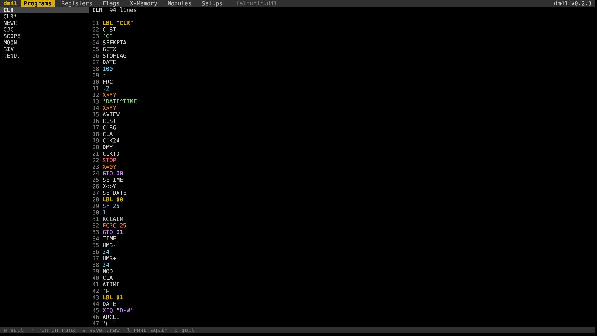
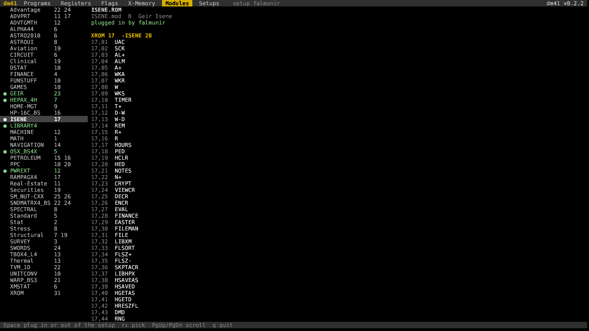
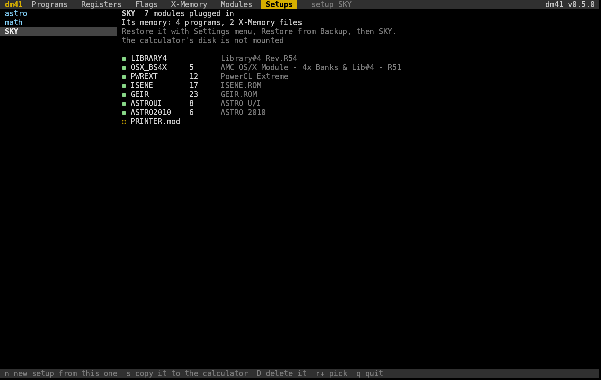
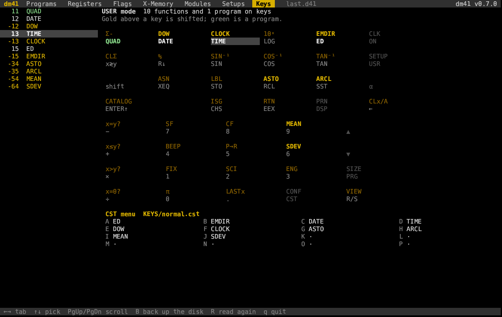
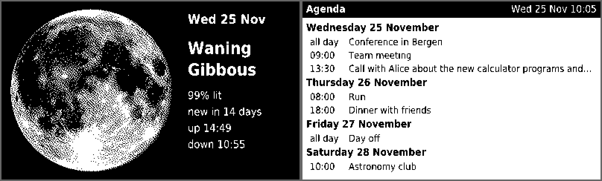

# dm41


**Your DM41X calculator in the terminal: programs, memory and modules. Written in Rust.**

    

A twin of the [SwissMicros DM41X](https://www.swissmicros.com) calculator in
the terminal. It shows the programs, registers, flags and X-Memory files from
the state file the calculator writes to its disk, and every module on that
disk with its functions.

Edit a program in [scribe](https://github.com/isene/scribe), try it in
[rpnx](https://github.com/isene/rpnx), and save it as a `.raw` file the
calculator loads.

Part of the [Fe₂O₃](https://isene.org/fe2o3/) suite.



## Use

1. On the calculator, save the state (File menu, Save DM41 State File), then
   turn on USB disk mode (File menu, Activate USB Disk).
2. Run `dm41`. It mounts the disk at `/mnt/dm41x` and unmounts it when you
   quit, when a sudoers line lets it (below). Without that line, mount the
   disk yourself, for writing to copy files back, for example with
   `udisksctl mount -b /dev/disk/by-label/DM41X`.
3. dm41 reads the newest `.d41` in the disk's `STATE` folder and
   keeps a copy in `~/.dm41/last.d41`, so it also works with the calculator
   unplugged.

| Key | Does |
|---|---|
| Left / Right | Change tab: Programs, Registers, Flags, X-Memory, Modules, Setups, Keys |
| Up / Down | Pick a program, a file, a module or a setup |
| PgUp / PgDn | Scroll the right side |
| `e` | Edit the program in scribe; `NAME.raw` is saved when scribe ends. In X-Memory, edit a text file |
| `l` | Load a program (a `.raw` or a listing), or in X-Memory a text file, into the setup |
| `B` | Copy the calculator's whole disk to `~/.dm41/backups` |
| `r` | Run the program in rpnx |
| `s` | Save `NAME.raw`; in Setups, copy the setup to the calculator |
| Space | In Modules, plug the module in or out of the setup; in Programs, X-Memory and Flags, put it in or out of the setup's memory |
| `n` | In Setups, make a new setup with the same modules |
| `D` | In Setups, delete the setup from the calculator; a copy goes to `~/.dm41/deleted` |
| `R` | Read the state again |
| `q` | Quit |

The first edit writes the program as a listing to `~/.dm41/prog/NAME.txt`;
later edits, runs and saves use that file. Delete it to start again from the
calculator's version. A `.raw` file goes to `~/.dm41/prog`, and to the
calculator's `PROG` folder when its disk can be written. Load it on the
calculator with File menu, Load RAW Program.

## Modules and setups

The Modules tab lists every `.MOD` file on the calculator's disk, with its
XROM number and the names of its functions. dm41 keeps a copy of the modules
in `~/.dm41/disk`, so the tab also works with the calculator unplugged.



A setup is a list of the modules to plug in (an `.m41` file). The calculator
writes one with each full backup; those stay as they are. `n` copies one
under a new name, and Space in Modules plugs a module in or out of it. A new
setup goes to the disk's `MODS` folder. Load it on the calculator with Module
menu, Load Modules, Load Flash and AM Lists. The memory stays as it is.

Program listings use the names from the modules of the picked setup.

## A setup with a memory of its own

A setup made with `n` can also carry programs, X-Memory files and flags.
Pick it in Setups, then press Space in Programs, X-Memory or Flags: each
program, file or flag goes in or out of the setup's memory. A green dot
marks what the setup has, and a blue one what only the setup has.

A new setup starts with the calculator's memory, or with the memory of the
backup it was copied from.

`l` loads a program from a `.raw` file or a listing, and in X-Memory a
text file, one record per line. Both go into the setup, in place of one
with the same name. When you edit a program the setup has, the setup gets
the new version when scribe ends; Space puts your edited version in, if
you have one. `e` in X-Memory edits a text file the same way.

dm41 writes such a setup as a full backup: `NAME.b41`, `NAME.d41`,
`NAME.m41` in the disk's `BACKUP` folder, with `NAME.ram` and `NAME.cst`
copied from the newest backup. Load it on the calculator with Settings
menu, Restore from Backup, then NAME. That loads the modules and the
memory together.

Make a full backup on the calculator first, so you can go
back. dm41 never writes over the calculator's own backups.



## Deleting a setup

The calculator cannot delete files itself. `D` in Setups deletes the
picked setup from its disk: the files of a full backup in `BACKUP`, or a
setup dm41 made with its `.m41` in `MODS`. dm41 asks first, and moves the
files to `~/.dm41/deleted/NAME_DATE`, so you can copy them back. The disk
must be mounted for writing.

## The keys in USER mode

The Keys tab draws the DM41X keyboard with what USER mode puts on it: the
functions given a key with ASN, shifted ones in gold above the key, and the
programs whose label has a key, in green. Under it are the CST menus from
the calculator's `KEYS` folder. Up and Down pick a key from the list and
show it on the keyboard.



## Backing up the calculator

`B` copies every file on the calculator's disk to
`~/.dm41/backups/DATE_TIME`. The memory in it is what the calculator last
saved, as a state file or a full backup, so save one first. To go back,
copy the files back to the disk.

## Pictures for when it is off

The calculator shows a picture from its OFFIMG folder while it is off,
the next one each time it is turned off. dm41 can make three: the Moon
as it is now, your next days from tock, and a photo. Name the ones you
want in `~/.dm41/off`, one a line:

```
moon 51.48 0.00            the Moon, rising and setting at this latitude and longitude
agenda                     the next days from tock --agenda
photo ~/Pictures/me.jpg    a PNG or JPEG photo, cut to fill the screen
```

dm41 makes them when it starts, and on `R`, with the calculator's disk
mounted for writing. They are `dm41-moon.bmp`, `dm41-agenda.bmp` and
`dm41-photo.bmp`. A picture is written only when it changed, and other
pictures in the folder stay.

A photo with strong light and shade works best, since the screen has only
black and white. `dm41 --off DIR` puts the pictures in a folder instead,
to look at first.



## On the command line

```
dm41 --list [FILE.d41]        every program as a listing
dm41 --raw NAME [FILE.d41]    one program as a .raw file, on stdout
dm41 --xm NAME [FILE.d41]     what an X-Memory file holds
dm41 --encode LISTING         a listing as a .raw file, on stdout
dm41 --mount                  mount the calculator's disk for writing
dm41 --unmount                unmount it, so the calculator can be unplugged
dm41 --off [DIR]              write the pictures ~/.dm41/off names to the calculator, or to DIR
```

## Mounting without a password

dm41 runs `sudo -n` to mount and unmount the disk. This line in
`/etc/sudoers.d/dm41` lets it, with your user name, uid and gid in place of
`you` and `1000` (`id` shows them). Make the folder `/mnt/dm41x` first.

```
you ALL=(root) NOPASSWD: /usr/bin/mount -o rw\,uid\=1000\,gid\=1000 /dev/disk/by-label/DM41X /mnt/dm41x, /usr/bin/umount /mnt/dm41x
```

A listing has one step per line, with or without step numbers, using the
HP-41's own names (`X^2`, `ENTER^`, `"⊢TEXT"` for an append). Functions of
the 41CX and of the setup's modules are known by name; functions of other
modules show as `XROM 05,03` and can be written that way.

## Build

```
cargo build --release
```

dm41 needs [crust](https://github.com/isene/crust) beside it.

## License

[Unlicense](https://unlicense.org): public domain.
