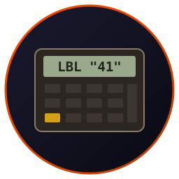

# dm41



A twin of the [SwissMicros DM41X](https://www.swissmicros.com) calculator in
the terminal. It shows the programs, registers, flags and X-Memory files from
the state file the calculator writes to its disk, and every module on that
disk with its functions.

Edit a program in [scribe](https://github.com/isene/scribe), try it in
[rpnx](https://github.com/isene/rpnx), and save it as a `.raw` file the
calculator loads.

Part of the [Fe₂O₃](https://isene.org/fe2o3/) suite.

<br clear="left"/>

## Use

1. On the calculator, save the state (File menu, Save DM41 State File), then
   turn on USB disk mode (File menu, Activate USB Disk).
2. Mount the disk on the computer. To copy `.raw` files back, mount it for
   writing, for example with `udisksctl mount -b /dev/disk/by-label/DM41X`.
3. Run `dm41`. It reads the newest `.d41` in the disk's `STATE` folder and
   keeps a copy in `~/.dm41/last.d41`, so it also works with the calculator
   unplugged.

| Key | Does |
|---|---|
| Left / Right | Change tab: Programs, Registers, Flags, X-Memory, Modules, Setups |
| Up / Down | Pick a program, a file, a module or a setup |
| PgUp / PgDn | Scroll the right side |
| `e` | Edit the program in scribe; `NAME.raw` is saved when scribe ends |
| `r` | Run the program in rpnx |
| `s` | Save `NAME.raw`; in Setups, copy the setup to the calculator |
| Space | In Modules, plug the module in or out of the setup |
| `n` | In Setups, make a new setup with the same modules |
| `R` | Read the state again |
| `q` | Quit |

The first edit writes the program as a listing to `~/.dm41/prog/NAME.txt`;
later edits, runs and saves use that file. Delete it to start again from the
calculator's version. A `.raw` file goes to `~/.dm41/prog`, and to the
calculator's `PROG` folder when its disk can be written. Load it on the
calculator with File menu, Load RAW Program.

## Modules and setups

The Modules tab lists every `.MOD` file on the calculator's disk, with its
XROM number and the names of its functions. dm41 keeps a copy of the modules
in `~/.dm41/disk`, so the tab also works with the calculator unplugged.

A setup is a list of the modules to plug in (an `.m41` file). The calculator
writes one with each full backup; those stay as they are. `n` copies one
under a new name, and Space in Modules plugs a module in or out of it. A new
setup goes to the disk's `MODS` folder. Load it on the calculator with Module
menu, Load Modules, Load Flash and AM Lists. The memory stays as it is.

Program listings use the names from the modules of the picked setup.

## On the command line

```
dm41 --list [FILE.d41]        every program as a listing
dm41 --raw NAME [FILE.d41]    one program as a .raw file, on stdout
dm41 --xm NAME [FILE.d41]     what an X-Memory file holds
dm41 --encode LISTING         a listing as a .raw file, on stdout
```

A listing has one step per line, with or without step numbers, using the
HP-41's own names (`X^2`, `ENTER^`, `"⊢TEXT"` for an append). Functions of
the 41CX and of the setup's modules are known by name; functions of other
modules show as `XROM 05,03` and can be written that way.

## Build

```
cargo build --release
```

dm41 needs [crust](https://github.com/isene/crust) beside it.

## License

[Unlicense](https://unlicense.org): public domain.
